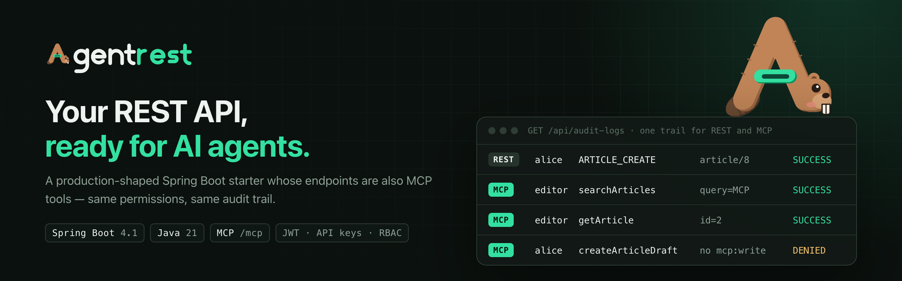
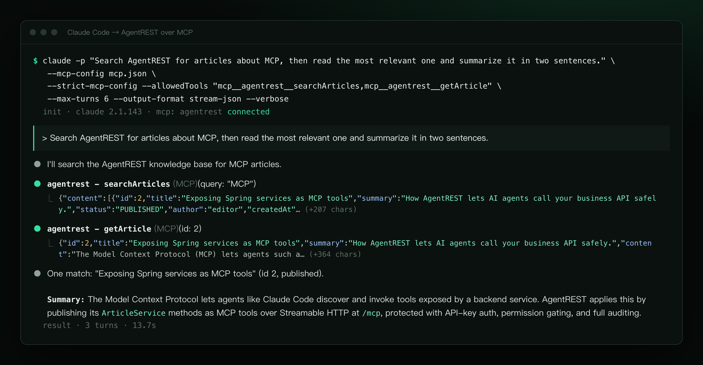
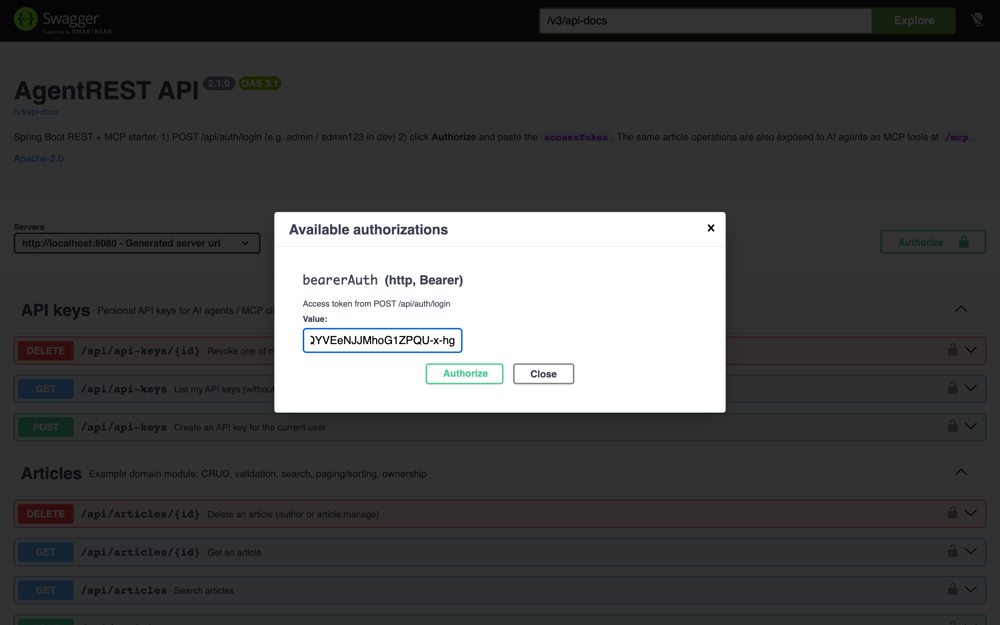
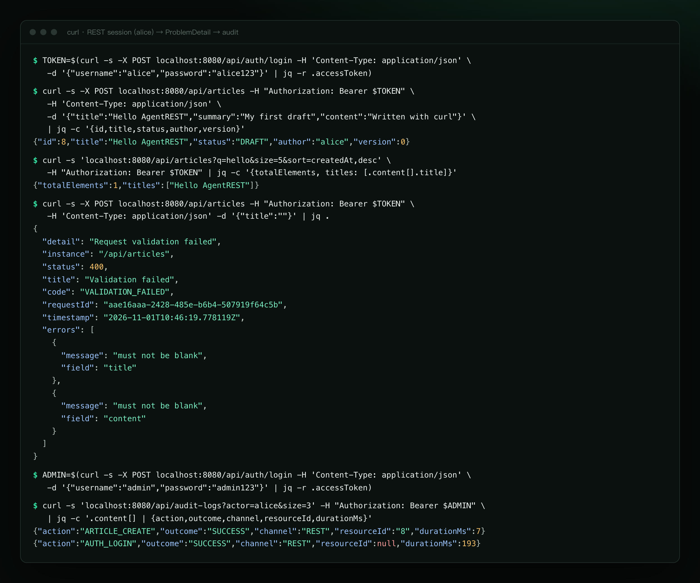
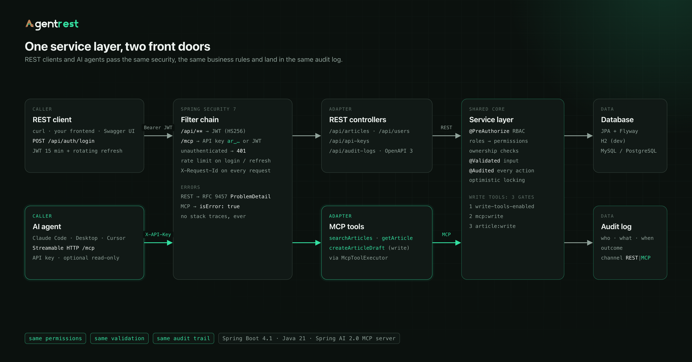
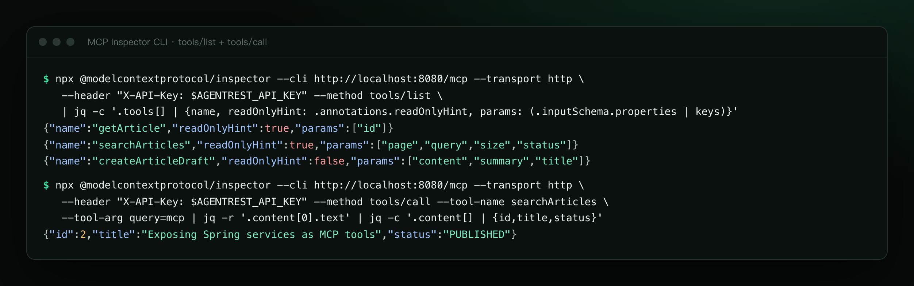
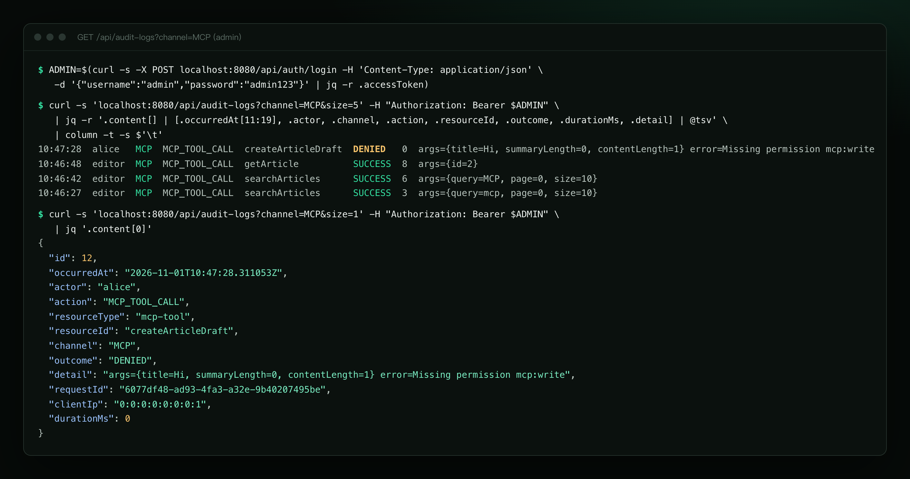

<p align="center">
  <a href="https://melonlee.github.io/AgentREST/"></a>
</p>

# AgentREST

<sub>原名 LazyREST（2026-11 改名）</sub>

> **Spring Boot REST + MCP 脚手架 —— 你的业务 API，让 AI Agent 安全调用。** 一个**诚实的、生产级形态**的 Spring Boot REST 脚手架 —— 你的业务接口，同时也是 AI Agent 可以安全调用的 **MCP 工具**：同样的权限，同样的审计。

[](https://github.com/melonlee/AgentREST/actions/workflows/ci.yml)
[](LICENSE)


[](https://github.com/melonlee/AgentREST/generate)

**[官网](https://melonlee.github.io/AgentREST/)** · **[Use this template](https://github.com/melonlee/AgentREST/generate)** · [1 分钟快速开始](#1-分钟快速开始) · [MCP 接入](#让-ai-agent-调用你的接口mcp)

简体中文 | [English](README.en.md)

 吉祥物是一只**河狸**：你专心写业务，它两只爪子各攥一个插头，把你的 API 接到 AI Agent 上（MCP 就是 AI 的 USB-C）。它和喵想一样，属于 FantasyAI Lab 吉祥物家族。

AgentREST v2 有两个支柱：

1. **小而真实的生产级 REST 基线** —— 一条命令跑起来，所有功能都有测试覆盖，README 里写的每一项都真的实现了。
2. **AI-ready** —— 选定的 Service 方法通过 Spring AI 的 MCP Server 暴露为 **MCP 工具**（Model Context Protocol），Claude Code / Claude Desktop / Cursor 等 Agent 可以直接调用你的业务 API；权限、所有权校验、参数校验、审计与 REST 完全共用同一套规则。



<sub>真实的 `claude -p` 运行记录（stream-json 原文排版成终端样式），两次工具调用都以 `channel=MCP` 记入审计日志。</sub>

---

## 目录

- [功能清单](#功能清单)
- [1 分钟快速开始](#1-分钟快速开始)
- [用 curl 走一遍](#用-curl-走一遍)
- [让 AI Agent 调用你的接口（MCP）](#让-ai-agent-调用你的接口mcp)
- [Docker Compose（MySQL）](#docker-composemysql)
- [项目结构](#项目结构)
- [配置与环境变量](#配置与环境变量)
- [安全说明](#安全说明)
- [测试](#测试)
- [作为模板使用](#作为模板使用)
- [路线图](#路线图)

---

## 功能清单

以下每一项都已实现，并有自动化测试覆盖。

| 模块 | 内容 |
|---|---|
| **auth** | 用户名密码登录（BCrypt）、JWT 访问令牌（HS256，15 分钟）、**不透明刷新令牌**（哈希存储、每次使用即轮换、重用检测会吊销整组令牌）、登出、可开关的自助注册、`/api/auth/me`；登录/刷新/注册按 IP **限流**（429 + `Retry-After`） |
| **API Key** | 个人 API Key（`ar_` 前缀，2.0 签发的 `lr_` Key 继续有效；只存 SHA-256，明文只显示一次，可吊销，可设为**只读**），专供 MCP 客户端使用 |
| **user** | RBAC：角色（`ROLE_ADMIN` / `ROLE_EDITOR` / `ROLE_USER`）+ 细粒度权限（`article:write`、`audit:read`、`mcp:write` …），`@PreAuthorize` 方法级安全，管理员用户管理接口，首个管理员通过环境变量引导创建 |
| **article**（示例领域） | CRUD、Jakarta Validation、分页 + 排序（白名单）、搜索（安全转义的 LIKE）、状态/作者过滤、**所有权校验**（草稿对他人返回 404，修改他人文章 403）、乐观锁、发布流程 |
| **audit** | `@Audited` AOP 审计：谁 / 做了什么 / 资源 / 何时 / 结果（SUCCESS / DENIED / FAILURE）/ 渠道（REST / MCP）/ requestId / IP / 耗时，独立事务持久化，管理员可按条件查询 |
| **common** | RFC 9457 `application/problem+json` 错误响应（含 `code`、`requestId`、字段级 `errors`）、`X-Request-Id` 请求追踪（日志 MDC）、统一分页 DTO |
| **mcp** | Streamable HTTP MCP 端点 `/mcp`：`searchArticles`、`getArticle`、`createArticleDraft`；必须认证（API Key 或 JWT）；写工具三重门控；**每次工具调用都审计** |
| **持久化** | Spring Data JPA + **Flyway** 迁移（无 `ddl-auto`，Hibernate 只校验）；dev = H2 内存库 + 演示数据；prod = MySQL 8（PostgreSQL 同样可用） |
| **运维** | springdoc OpenAPI 3 + Swagger UI（带 JWT Authorize 按钮）、Actuator（仅 health 公开，其余需 ADMIN）、Prometheus 指标、优雅停机、虚拟线程 |
| **交付** | Maven Wrapper、多阶段 Dockerfile（分层 jar、非 root）、docker-compose（app + MySQL）、GitHub Actions CI（含 Testcontainers MySQL/PostgreSQL） |

**v2 刻意不包含**（不写就不吹）：缓存 / Redis、文件上传、XSS 过滤器、API 版本管理、多租户、OAuth2 授权服务器、MFA。需要时再加 —— 见[路线图](#路线图)。

---

## 1 分钟快速开始

只需要 **JDK 21**（不需要数据库、Redis 或 Docker）：

```bash
git clone https://github.com/melonlee/AgentREST.git
cd AgentREST
./mvnw spring-boot:run
```

- Swagger UI：<http://localhost:8080/swagger-ui.html>（先调用 `POST /api/auth/login`，再点 **Authorize** 粘贴 `accessToken`）
- 健康检查：<http://localhost:8080/actuator/health>
- MCP 端点：`http://localhost:8080/mcp`

dev 环境自动创建的演示账号（**仅 dev profile**，prod 不会创建）：

| 用户名 / 密码 | 角色 | 能做什么 |
|---|---|---|
| `admin` / `admin123` | ROLE_ADMIN | 全部权限：用户管理、审计查询、Actuator |
| `editor` / `editor123` | ROLE_EDITOR | 写 + 发布文章，可用 MCP 写工具 |
| `alice` / `alice123` | ROLE_USER | 读文章、写自己的草稿 |
| `bob` / `bob123456` | ROLE_USER | 同上 |

演示 API Key（绑定 `editor`，可读写）：`ar_dev_editor_0123456789abcdefghijklmnop`（改名前的 `lr_dev_editor_…` 也会被创建，用来验证旧前缀兼容）



---

## 用 curl 走一遍

<details><summary>截图：同一组命令的真实终端输出（以 ProblemDetail 和审计查询结尾）</summary>



</details>

下面的命令在本地实测通过（需要 `jq`）：

```bash
# 1. 登录拿令牌
TOKEN=$(curl -s -X POST localhost:8080/api/auth/login -H 'Content-Type: application/json' \
  -d '{"username":"alice","password":"alice123"}' | jq -r .accessToken)

# 2. 创建草稿（201 + Location）
curl -s -X POST localhost:8080/api/articles -H "Authorization: Bearer $TOKEN" \
  -H 'Content-Type: application/json' \
  -d '{"title":"Hello AgentREST","summary":"My first draft","content":"Written with curl"}' | jq -c .
# {"id":8,"title":"Hello AgentREST",...,"status":"DRAFT","author":"alice",...,"version":0}

# 3. 搜索 + 分页 + 排序
curl -s "localhost:8080/api/articles?q=hello&size=5&sort=createdAt,desc" \
  -H "Authorization: Bearer $TOKEN" | jq -c '{totalElements, titles: [.content[].title]}'
# {"totalElements":1,"titles":["Hello AgentREST"]}

# 4. 更新（乐观锁 version +1）
curl -s -X PUT localhost:8080/api/articles/8 -H "Authorization: Bearer $TOKEN" \
  -H 'Content-Type: application/json' -d '{"title":"Hello AgentREST v2","content":"Edited"}' | jq -c '{id,title,version}'
# {"id":8,"title":"Hello AgentREST v2","version":1}

# 5. 校验失败 -> RFC 9457 ProblemDetail
curl -s -X POST localhost:8080/api/articles -H "Authorization: Bearer $TOKEN" \
  -H 'Content-Type: application/json' -d '{"title":""}' | jq .
```

```json
{
  "detail": "Request validation failed",
  "instance": "/api/articles",
  "status": 400,
  "title": "Validation failed",
  "code": "VALIDATION_FAILED",
  "requestId": "978da650-5f5f-4404-b2d8-1e7e59184f93",
  "timestamp": "2026-11-01T06:58:11.749072Z",
  "errors": [
    { "field": "content", "message": "must not be blank" },
    { "field": "title", "message": "must not be blank" }
  ]
}
```

```bash
# 6. 没有发布权限 -> 403（同样会被审计为 DENIED）
curl -s -X POST localhost:8080/api/articles/8/publish -H "Authorization: Bearer $TOKEN" | jq -c '{status,code,detail}'
# {"status":403,"code":"FORBIDDEN","detail":"You do not have permission to perform this action"}

# 7. 管理员查看审计日志
ADMIN=$(curl -s -X POST localhost:8080/api/auth/login -H 'Content-Type: application/json' \
  -d '{"username":"admin","password":"admin123"}' | jq -r .accessToken)
curl -s "localhost:8080/api/audit-logs?actor=alice&size=5" -H "Authorization: Bearer $ADMIN" \
  | jq -c '.content[] | {actor, action, resourceId, channel, outcome}'
# {"actor":"alice","action":"ARTICLE_PUBLISH","resourceId":"8","channel":"REST","outcome":"DENIED"}
# {"actor":"alice","action":"ARTICLE_UPDATE","resourceId":"8","channel":"REST","outcome":"SUCCESS"}
# {"actor":"alice","action":"ARTICLE_CREATE","resourceId":"8","channel":"REST","outcome":"SUCCESS"}
# ...
```

错误语言默认英文，可通过 `Accept-Language: zh-CN` 获取中文校验信息。

---

## 让 AI Agent 调用你的接口（MCP）

2026 年，团队越来越需要把**已有的业务 API** 开放给 AI Agent。AgentREST 的做法是：Agent 不直连数据库，也不绕过业务规则，而是通过 MCP 调用**同一个 Service 层** —— 和 REST 共享权限、所有权、校验与审计。



### 暴露的工具

| 工具 | 类型 | 说明 |
|---|---|---|
| `searchArticles` | 只读 | 按关键字 / 状态搜索文章（已发布 + 自己的草稿），分页 |
| `getArticle` | 只读 | 按 id 读取全文；看不到的草稿返回 “not found” |
| `createArticleDraft` | 写 | 以调用者身份创建**草稿**；发布永远需要人工（仅 REST） |

工具带有 JSON Schema 与 MCP 提示（`readOnlyHint`、`destructiveHint` …），描述专为模型编写。

### 安全模型

- `/mcp` 必须认证：`X-API-Key: ar_…`（或 `Authorization: Bearer ar_…`；LazyREST 2.0 签发的 `lr_…` Key 继续有效），也接受普通 JWT。未认证返回 401 ProblemDetail。
- Agent 的权限 = API Key 主人的权限；**只读 Key** 只保留 `*:read` 权限。
- 写工具三重门控：`agentrest.mcp.write-tools-enabled`（prod 默认关闭，关闭时工具根本不会出现在 `tools/list`）→ `mcp:write` 权限 → Service 层 `article:write`。
- 每次工具调用记录一条 `MCP_TOOL_CALL` 审计（含参数摘要、结果、耗时），内部业务操作也会以 `channel=MCP` 记录。
- 工具错误以 `isError: true` + 一句可读的话返回给模型（不含堆栈、不泄露内部信息）。

创建你自己的 API Key（推荐只读）：

```bash
curl -s -X POST localhost:8080/api/api-keys -H "Authorization: Bearer $TOKEN" \
  -H 'Content-Type: application/json' -d '{"name":"claude-code on my laptop","readOnly":true}' | jq .
# 返回中的 apiKey 只显示这一次
```

### Claude Code

```bash
claude mcp add --transport http agentrest http://localhost:8080/mcp \
  --header "X-API-Key: ar_dev_editor_0123456789abcdefghijklmnop"
```

或者提交到项目的 `.mcp.json`（Key 从环境变量读取，不进仓库）：

```json
{
  "mcpServers": {
    "agentrest": {
      "type": "http",
      "url": "http://localhost:8080/mcp",
      "headers": {
        "X-API-Key": "${AGENTREST_API_KEY}"
      }
    }
  }
}
```

```bash
export AGENTREST_API_KEY=ar_dev_editor_0123456789abcdefghijklmnop
claude mcp list   # agentrest: http://localhost:8080/mcp (HTTP) - ✓ Connected
```

### Claude Desktop

Claude Desktop 的配置文件只支持本地（stdio）服务器，用 [`mcp-remote`](https://github.com/geelen/mcp-remote) 桥接（需要 Node.js）。编辑 `claude_desktop_config.json`：

```json
{
  "mcpServers": {
    "agentrest": {
      "command": "npx",
      "args": ["-y", "mcp-remote", "http://localhost:8080/mcp", "--header", "X-API-Key:${AGENTREST_API_KEY}"],
      "env": {
        "AGENTREST_API_KEY": "ar_dev_editor_0123456789abcdefghijklmnop"
      }
    }
  }
}
```

其他支持 Streamable HTTP 的客户端（Cursor 等）：URL 填 `http://localhost:8080/mcp`，请求头加 `X-API-Key`，具体格式见各客户端文档。

### 用 MCP Inspector 调试

```bash
npx -y @modelcontextprotocol/inspector --cli http://localhost:8080/mcp --transport http \
  --header "X-API-Key: ar_dev_editor_0123456789abcdefghijklmnop" --method tools/list

npx -y @modelcontextprotocol/inspector --cli http://localhost:8080/mcp --transport http \
  --header "X-API-Key: ar_dev_editor_0123456789abcdefghijklmnop" \
  --method tools/call --tool-name searchArticles --tool-arg query=mcp
```



### 可以这样问 Agent

- “用 agentrest 搜索和 MCP 相关的文章，总结要点。”
- “读一下第 2 篇文章，帮我改写成面向初学者的版本，用 createArticleDraft 存成草稿。”
- “列出我所有的草稿，告诉我哪些还缺摘要。”

然后在审计日志里能看到 Agent 做的每一件事：`GET /api/audit-logs?channel=MCP`。



### 暴露你自己的工具

在任意 Spring Bean 上写一个 `@McpTool` 方法，调用你的 Service，并交给 `McpToolExecutor`（负责身份绑定、权限、审计和错误翻译）：

```java
@McpTool(name = "getOrder", description = "Get one order by id, including its items and status.",
        annotations = @McpTool.McpAnnotations(readOnlyHint = true, destructiveHint = false))
public CallToolResult getOrder(McpTransportContext ctx,
        @McpToolParam(description = "Order id") long id) {
    return executor.call("getOrder", ctx, Map.of("id", id), null, () -> orderService.get(id));
}
```

---

## Docker Compose（MySQL）

```bash
cp .env.example .env      # 填入 JWT_SECRET（openssl rand -base64 48）、数据库密码、管理员密码
docker compose up --build
```

app 使用 `prod` profile 连接 MySQL 8.4，Flyway 自动建表，首次启动按 `AGENTREST_ADMIN_*` 创建管理员。缺少任何必需的环境变量时，compose 和应用都会**直接拒绝启动**并指出缺了什么。

使用 PostgreSQL：把 `DB_URL` 换成 `jdbc:postgresql://host:5432/agentrest` 即可（Flyway 自动选择 `db/migration/postgresql`）。

---

## 项目结构

```
src/main/java/com/fantasyailab/agentrest/
├── AgentRestApplication.java
├── auth/            登录 / 刷新 / 登出 / 注册 / me、JWT、限流、SecurityConfig
│   └── apikey/      API Key 实体、服务、过滤器、接口
├── user/            User / Role / Permission、用户管理、首个管理员引导
├── article/         示例领域模块（可整体删除）
├── audit/           @Audited、切面、审计日志实体与查询接口
├── mcp/             MCP 工具、McpToolExecutor、传输层配置
├── common/
│   ├── api/         PageResponse、排序白名单、LIKE 转义
│   ├── error/       ProblemDetail 异常体系与全局处理
│   ├── security/    SecurityUtils、安全令牌工具
│   ├── web/         RequestIdFilter
│   └── config/      OpenAPI、prod 配置守卫
└── dev/             DevDataSeeder（仅 dev profile）
src/main/resources/
├── application.yml / application-dev.yml / application-prod.yml
└── db/migration/{mysql,postgresql}/   Flyway 脚本
docs/decisions.md    技术选型与取舍
```

---

## 配置与环境变量

| 变量 | 默认值 | 说明 |
|---|---|---|
| `SPRING_PROFILES_ACTIVE` | `dev` | `dev`（H2 + 演示数据）或 `prod` |
| `DB_URL` | — | **prod 必填**，如 `jdbc:mysql://db:3306/agentrest` |
| `DB_USERNAME` / `DB_PASSWORD` | — | **prod 必填** |
| `DB_POOL_SIZE` | `10` | Hikari 连接池大小 |
| `JWT_SECRET` | dev 内置的明显假值 | **prod 必填**，≥ 32 字节；dev 假值在 prod 下会被拒绝 |
| `AGENTREST_ADMIN_USERNAME` / `_EMAIL` / `_PASSWORD` | — | 数据库没有任何用户时创建首个管理员（密码 ≥ 12 位） |
| `MCP_WRITE_TOOLS_ENABLED` | dev `true` / prod `false` | 是否注册 MCP 写工具 |
| `REGISTRATION_ENABLED` | dev `true` / prod `false` | 是否开放自助注册 |
| `API_DOCS_ENABLED` | prod `false` | prod 下是否开放 Swagger UI / OpenAPI |
| `CORS_ALLOWED_ORIGINS` | 空（关闭） | 逗号分隔的允许来源 |
| `FORWARD_HEADERS_STRATEGY` | `none` | 部署在反向代理后设为 `native` 或 `framework`，否则限流和审计看到的是代理 IP |

其他可调属性（`application.yml`）：`agentrest.security.jwt.access-token-ttl`（15m）、`refresh-token-ttl`（14d）、`agentrest.auth.login-rate-limit.max-attempts`（10）/ `window`（1m）。

---

## 安全说明

- **仓库里没有任何密钥**。dev 的 JWT 密钥以 `dev-only-` 开头，和 `prod` profile 一起使用会被拒绝启动。
- 密码使用 BCrypt（`DelegatingPasswordEncoder`，可平滑升级算法）。登录失败对“用户不存在”和“密码错误”返回相同信息。
- 访问令牌 15 分钟有效，权限写在令牌里：角色变更最晚在下一次刷新时生效；禁用用户立即无法登录和刷新。
- 刷新令牌与 API Key 都是 256 位随机值，只存 SHA-256；API Key 只在 `/mcp` 上被接受。
- 限流是**单实例内存**实现：多副本时每个实例单独计数。
- CSRF 关闭：API 完全无状态，只用 Bearer 令牌，不使用 Cookie。CORS 默认关闭。
- 错误响应永不包含堆栈或内部信息；500 只返回 `requestId`，用于对照日志。
- Actuator 只公开 `health`，其余端点需要 ADMIN。
- **MCP 注意事项**：注册一个工具就等于把它开放出去；Agent 读到的数据会进入模型上下文；用户写入的内容可能包含针对 Agent 的提示注入 —— 因此 Agent 只能创建草稿，发布必须由人完成。
- 未覆盖：MFA、账户锁定（只有限流）、MCP 的 OAuth 授权、TLS（请在反向代理终止）。

---

## 测试

```bash
./mvnw verify                      # 70 个测试，H2，不需要 Docker
./mvnw -Ptestcontainers test       # MySQL 8.4 + PostgreSQL 17（Testcontainers，需要 Docker）
```

覆盖：单元测试（限流、JWT 配置快速失败、prod 配置守卫、查询工具）、`@WebMvcTest`（绑定、校验、ProblemDetail）、`@DataJpaTest`（Flyway 迁移 + Hibernate 校验 + 查询）、全栈 `@SpringBootTest`（登录/刷新轮换/重用检测、RBAC、所有权、分页排序、审计、限流）、MCP（用官方 MCP Java SDK 客户端走 `initialize` → `tools/list` → `tools/call`，覆盖认证、只读 Key、权限拒绝、审计）。CI 中还会以 `prod` profile 在真实 MySQL / PostgreSQL 上跑通全流程。

---

## 作为模板使用

在 GitHub 上点 **Use this template**（或打开 <https://github.com/melonlee/AgentREST/generate>）创建你自己的仓库，然后：

1. **改坐标**：修改 `pom.xml` 的 `groupId` / `artifactId` / `name`。
2. **改包名**：用 IDE 把 `com.fantasyailab.agentrest` 重命名为你的包（或 `git mv` 目录后全局替换 `com.fantasyailab.agentrest`）。
3. **删除示例模块**：
   - 删除 `article/` 包、`mcp/ArticleMcpTools.java`、`mcp/ArticleWriteMcpTools.java`；
   - 在尚未上线前直接从 `V1__schema.sql` 删掉 `articles` 表（已上线则新增迁移 `DROP TABLE`）；
   - 删除 `DevDataSeeder` 中的文章数据，以及 `ArticleApiTests`、`ArticleControllerWebMvcTest`、MCP 测试中与文章相关的部分。
4. **加你的领域**：`Entity + Repository + Service（@PreAuthorize / @Audited / @Validated）+ Controller`，需要给 Agent 用时再加一个 `@McpTool` 适配器。
5. 新权限加到 `V2__reference_data.sql`（或新的迁移脚本）里。

---

## 路线图

- [ ] MCP 的 OAuth 2.1 授权（RFC 9728 元数据 + 授权服务器），让远程客户端无需静态 Key
- [ ] 更多 MCP 示例：Resources 与 Prompts
- [ ] 可选的 Redis：分布式限流与缓存
- [ ] Stateless MCP 模式，便于水平扩展
- [ ] OpenTelemetry 链路追踪
- [ ] 项目生成器（替换包名 / 去掉示例模块一步完成）

## 从 LazyREST 2.0 升级

AgentREST 2.1 就是改名后的 LazyREST 2.0：REST API、表结构和 Flyway 迁移都没有变化，已有数据库可以直接升级。变化如下（详见 [CHANGELOG](CHANGELOG.md)）：

- 包名 `com.lazy.rest` → `com.fantasyailab.agentrest`，Maven 坐标 `com.fantasyailab:agentrest`（`target/agentrest-2.1.0.jar`），Docker 镜像 `agentrest`。
- 配置前缀 `lazyrest.*` → `agentrest.*`；环境变量 `LAZYREST_ADMIN_*` → `AGENTREST_ADMIN_*`（旧名仍作为兜底生效）。
- MCP 服务名 `lazyrest` → `agentrest`：在客户端里重新添加（`claude mcp add --transport http agentrest …`），并更新 `.mcp.json` 的键名和 `mcp__agentrest__…` 工具白名单。
- 新签发的 API Key 以 `ar_` 开头，已有的 `lr_` Key 继续有效。dev 演示 Key 改为 `ar_dev_editor_…`（dev 环境仍会同时创建旧的 `lr_dev_editor_…`）。
- JWT issuer `lazyrest` → `agentrest`：升级前签发的访问令牌会被拒绝，重新登录或用刷新令牌换新即可。

## 从 v1 升级

v2 是重写，不兼容 v1：Java 21、Spring Boot 4.1、Flyway 管理表结构、API 前缀从 context-path `/api` 改为控制器路径 `/api/...`。详见 [CHANGELOG](CHANGELOG.md)。v1 代码保留在 git 历史中。

## 许可证

[Apache License 2.0](LICENSE)

---

由 [Melon](https://github.com/melonlee) / [FantasyAI Lab](https://fantasyailab.com/) 维护 · [官网](https://melonlee.github.io/AgentREST/)。觉得有用就点个 ⭐，欢迎提 Issue / PR。
